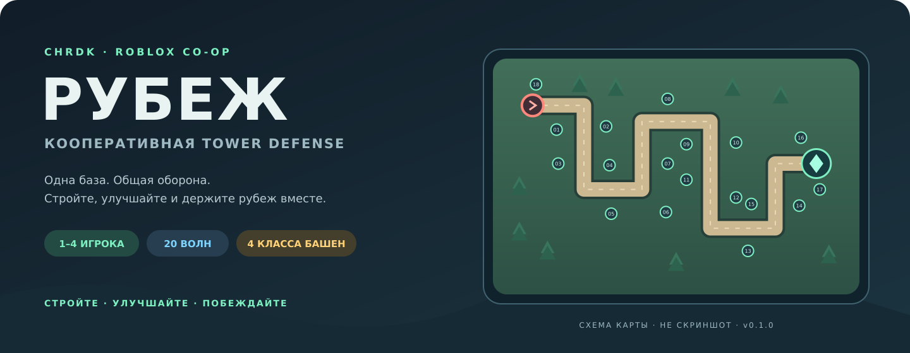

<div align="center">



# РУБЕЖ

**Кооперативная tower defense для Roblox на 1–4 игроков**

[](https://github.com/cherdakmd/CHRDK_TD_ROBLOX/actions/workflows/ci.yml)


[Быстрый старт](#-быстрый-старт) · [Возможности](#-возможности) · [Управление](#-управление) · [Публикация](#-публикация) · [Документация](#-документация)

</div>

> **Статус: играбельный прототип v0.1.1.** Основной игровой цикл собран и покрыт headless-тестами. Перед публикацией опыта обязательно пройдите [ручной чек-лист в Roblox Studio](docs/STUDIO_CHECKLIST_RU.md): мультиплеер, мобильный UI и облачные сохранения.

Одна база. Общая оборона. Игроки строят башни на общих площадках, улучшают свои башни, комбинируют урон и замедление и переживают **20 волн** с боссами. Интерфейс на русском. Карта, модели, враги и HUD создаются кодом — без внешних моделей и платных ассетов.

## 🚀 Быстрый старт

### Открыть готовый place

1. Скачайте [`release/CHRDK_Rubezh.rbxlx`](release/CHRDK_Rubezh.rbxlx) из репозитория или со страницы [Releases](https://github.com/cherdakmd/CHRDK_TD_ROBLOX/releases).
2. Откройте файл в **Roblox Studio**.
3. Нажмите **Play**.
4. Выберите площадку на карте, затем башню в нижней панели.
5. Нажмите **Я ГОТОВ** или дождитесь конца подготовки.

В Output ожидается строка `[РУБЕЖ] Server ready`. В локальном Studio-тесте профиль временный и не записывается в облако.

### Работать с исходниками через Rojo

Нужны [Rojo](https://rojo.space/) и плагин Rojo для Studio.

```bash
git clone https://github.com/cherdakmd/CHRDK_TD_ROBLOX.git
cd CHRDK_TD_ROBLOX
rojo serve default.project.json
```

Подключитесь плагином в Studio и нажмите **Play**. Либо пересоберите place без Rojo:

```bash
python3 tools/build_place.py
```

## ✨ Возможности

| Система | Что реализовано |
|---|---|
| Команда | 1–4 игроков, общее ядро, общие способности, личные золото и башни |
| Волны | 20 детерминированных волн, 6 типов врагов, боссы каждые 5 волн, усиленный финал |
| Башни | Страж, Мортира, Криомант, Тесла; уровни I–IV и три приоритета цели |
| Экономика | Награда по нанесённому урону, бонус волны, проценты за остаток, продажа за 70% |
| Способности | Метеор по точке и Стужа по всем врагам; общие перезарядки |
| Голосования | Готовность, сложность, 1×/2×, досрочная волна, рестарт |
| Прогресс | Опыт, уровень, победы, лучшая волна, добивания и число матчей |
| Интерфейс | Русский HUD, обучение, инспектор, магазин, отряд, мини-карта, результаты |
| Камера | Overhead-обзор, панорама, поворот, масштаб, мышь и мобильный ввод |
| Сервер | Авторитетный бой и экономика, валидация RemoteEvent, rate limit, проверка владельца |

Это прототип основного цикла, а не набор всех возможных механик жанра: пока одна карта, без монетизации, питомцев, трейда, матчмейкинга и лутбоксов.

## 🎮 Управление

| Действие | ПК | Мобильные |
|---|---|---|
| Выбрать площадку / точку метеора | ЛКМ | касание |
| Панорама камеры | WASD / стрелки / СКМ | перетаскивание |
| Поворот / наклон | ПКМ + мышь | — |
| Масштаб | колесо мыши | щипок |
| Сброс камеры | R | мини-карта |
| Выбор типа башни | 1–4 | карточки внизу |
| Улучшить выбранную башню | U | инспектор |
| Метеор | Q, затем точка | кнопка, затем касание |
| Стужа | E | кнопка |
| Готовность / ранняя волна | Пробел | кнопка |
| Помощь | H / `?` | `?` |
| Отмена | Esc | × в инспекторе |

Персонаж стоит на командной площадке: управление построено вокруг камеры командира, а не шутера от третьего лица.

## 🗼 Башни и баланс

| Башня | Цена | Роль | Воздух |
|---|---:|---|---|
| Страж | 160 | быстрый одиночный урон | да |
| Мортира | 280 | взрыв по площади, радиус 7 | нет |
| Криомант | 240 | замедление на 48% | да |
| Тесла | 360 | цепная молния до 3 соседей | да |

- Старт: **600 золота**. Улучшения повышают урон, радиус и темп стрельбы.
- Награда за врага делится пропорционально урону; остаток округления получает добивший.
- За волну: `80 + 12 × волна` плюс 3% от текущего золота, максимум 90 процентного бонуса.
- Продажа возвращает **70%** строительства и улучшений. Управлять башней может только владелец.
- Обычный режим: 30 HP ядра. Испытание: 20 HP, +35% здоровья врагов, +15% золота, +50% опыта.
- Каждый дополнительный игрок увеличивает здоровье врагов на 42%; золото и число башен тоже растут.
- Опоздавший игрок получает компенсацию за очищенные волны и размер отряда.
- 2× ускоряет бой и перезарядку способностей, но не таймеры лобби/передышки.

Все числа и координаты карты: [`src/shared/Config.luau`](src/shared/Config.luau).

## 📦 Публикация

1. Studio: **File → Publish to Roblox**.
2. В настройках места выставьте **Max Players = 4**. Сервер также не допускает пятого игрока, но штатный лимит Roblox нужно настроить отдельно.
3. Для проверки DataStore из Studio включите **Enable Studio Access to API Services** в опубликованном месте.
4. Пройдите [чек-лист](docs/STUDIO_CHECKLIST_RU.md): Play, Start Server/Players, мобильный экран, выход/повторный вход.
5. Для версии создайте тег `vX.Y.Z`; workflow `Release` проверит проект и приложит Studio-файл, исходники и SHA-256.

Подробнее: [`docs/RELEASE.md`](docs/RELEASE.md).

## 🧪 Проверка и разработка

```bash
python3 -m venv .venv
.venv/bin/pip install -r requirements-dev.txt
.venv/bin/python -m unittest discover -s tests -p 'test_*.py' -v
.venv/bin/python tests/run_tests.py --luau /path/to/luau
python3 tools/build_place.py
```

Headless-набор проверяет чистую логику, реальные серверные скрипты через mock Roblox API, клиентский HUD, сохранение/блокировку профилей и симуляцию соло-прохождения всех 20 волн. Mock не заменяет настоящий Studio-тест.

Правила доработки: [`CONTRIBUTING.md`](CONTRIBUTING.md). История версий: [`CHANGELOG.md`](CHANGELOG.md).

## 📚 Документация

- [`docs/ARCHITECTURE.md`](docs/ARCHITECTURE.md) — фазы матча, RemoteEvent-протокол, боевая модель и DataStore.
- [`docs/STUDIO_CHECKLIST_RU.md`](docs/STUDIO_CHECKLIST_RU.md) — ручная проверка перед релизом.
- [`docs/RELEASE.md`](docs/RELEASE.md) — публикация версии и артефакты.
- [`docs/assets/rubezh-preview.svg`](docs/assets/rubezh-preview.svg) — схема карты, не скриншот.

```text
src/
  shared/   Config, Path, Waves, Economy, Format
  server/   Main + Map, Models, Enemies, Towers, Profiles
  client/   Main + Camera, UI, Effects, Theme
tests/      Luau-логика, сервер, клиент, профиль, баланс
tools/      сборка .rbxlx и схема карты
release/    готовый Studio-файл
```

## 🔐 Сохранения и безопасность

Клиент отправляет намерения (`Build`, `Upgrade`, `Sell`, `Ability`, голосования), а сервер проверяет фазу, поля, золото, владельца и координаты. Постоянный профиль хранит только `xp`, `wins`, `bestWave`, `kills`, `matches`; золото и башни матча не переносятся.

Загрузка и запись идут через `UpdateAsync` с session-lock. При ошибке загрузки данные не перезаписываются значениями по умолчанию. Автосохранение — раз в 60 секунд, финальное — при выходе и `BindToClose`.

## Дальше

Звук и музыка, новые карты, косметические скины, ежедневные задания, таблицы лидеров, подбор команды и сезонные события. Текущая версия уже содержит законченный игровой цикл без этих дополнений.
